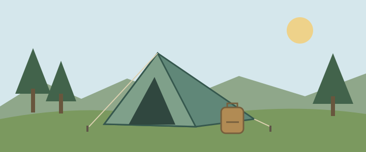

# Poprvé pod stan

Víkend pod stanem zní jednoduše. Sbalit batoh, dojet do kempu a dva dny nic neřešit. Jenže pak člověk zjistí, že má nabíječku, ale nemá spacák. Tohle je můj plán na krátký letní výlet do kempu.

## Co hodit do batohu

**Stan, spacák a karimatka** jsou základ. Zbytek se dá nějak domluvit, ale spát jen na mikině bych úplně zkoušet nechtěl.

- Oblečení na převlečení a něco proti dešti.
- Láhev na vodu a jídlo na cestu.
- Kartáček, ručník a základní hygienu.
- Čelovku nebo baterku.
- Pytel na odpadky, ať po nás nic nezůstane.

### Kontrola před odjezdem

- [x] Domluvit termín s ostatními.
- [x] Najít kemp.
- [ ] Zkontrolovat, jestli jsou u stanu všechny tyčky.
- [ ] Nabít mobil a baterku.
- [ ] Podívat se na předpověď.

*Nejdůležitější bod je asi ten se stanem. Zjistit to až na místě by bylo dost blbý.*

## Jak bude vypadat náš tábor



*Přibližná představa. Ve skutečnosti bude stan nejspíš trochu nakřivo.*

### Po příjezdu

Nejdřív se ohlásit na recepci a zjistit, kde můžeme stan postavit. Pak **postavit stan ještě za světla**, vybalit spaní a teprve potom řešit večeři. ~~Návod ke stanu přece nikdo nepotřebuje.~~ Radši ho vezmu taky.

## Co budeme jíst

| Jídlo | Proč ho vzít | Co je s ním za práci |
| --- | --- | --- |
| Pečivo a pomazánka | Rychlá večeře po příjezdu | Vzít takovou, kterou zvládneme správně skladovat |
| Kuskus | Nezabere moc místa | Potřebujeme horkou vodu |
| Jídlo z místního bufetu | Nemusíme nic vařit | Záleží na otevírací době a cenách |

### Rozpočet v Pythonu

Jednoduchý výpočet společných výdajů. Částky jsou jen příklad, skutečné ceny si doplníme před cestou.

```python
vydaje = {"kemp": 900, "doprava": 600, "jidlo": 750}
pocet_lidi = 3
celkem = sum(vydaje.values())

print(f"Dohromady: {celkem} Kč")
print(f"Na jednoho: {celkem / pocet_lidi:.0f} Kč")
```

## Co zjistit předem

Trasu a okolí si můžeme prohlédnout na [OpenStreetMap](https://www.openstreetmap.org/). Předpověď zkontrolujeme na [webu ČHMÚ](https://www.chmi.cz/). Ještě je potřeba ověřit pravidla a vybavení vybraného kempu.

Na první výlet stačí dvě noci. Když něco zapomeneme, aspoň budeme vědět co příště připsat na seznam.
